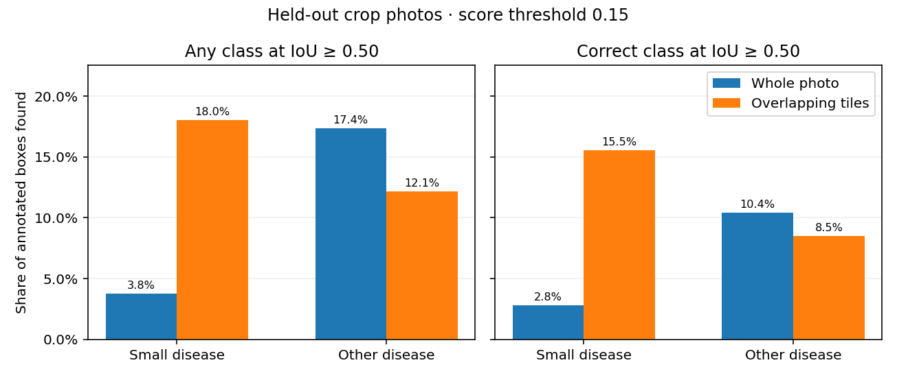

# Crop disease detection in Ghana

Can looking at a crop photo in overlapping pieces help find small disease spots? This study trains one compact detector on annotated farm photos of corn, pepper, and tomato, then compares two ways of scanning the same held-out photos.

## Results on 981 held-out photos

| Inference view | Small-box localization recall | Small-box recall with correct label | Other disease-box recall with correct label | mAP at IoU 0.50 |
| --- | ---: | ---: | ---: | ---: |
| Whole photo | 3.8% | 2.8% | 10.4% | 0.95% |
| Overlapping tiles | 18.0% | 15.5% | 8.5% | 0.69% |

The tiled view found **614 of 3,951 small disease boxes with the correct label**, up from 110 with the whole-photo view. Overall average precision was low for both views. The tiles helped preserve detail for small spots, while the whole-photo scan found more of the larger disease boxes with the correct label.

At the same score threshold, the tiled model labeled 28 matched tomato leaf-curl boxes as healthy tomato and 18 tomato early-blight boxes as tomato late blight. The [tiled confusion matrix](results/tiled_confusion.csv) also counts missed boxes and predictions that could not be matched to an annotation.



## How the experiment works

1. Read the bounding boxes and group them by photo. Remove byte-identical copies before splitting. Train on 3,920 photos and test on 981 different photos from the labeled training archive.
2. Train a small convolutional model for eight epochs on a mix of whole-photo and cropped views. It predicts a box center, size, and class for each occupied area of the image.
3. Scan each test photo once at a reduced resolution, then scan its overlapping tiles with the same weights. Merge highly overlapping predictions of the same class.
4. Count a match at intersection-over-union of at least 0.50. A small box covers less than 0.25% of the photo area. The size comparison uses a fixed score threshold of 0.15 and omits healthy classes. Average precision uses ranked predictions across all 23 labels.

The study measures an experimental baseline on the supplied photos. The low average precision matters for any use where a false alarm is costly. A split by farm or plant would require identifiers for those groups.

## Run it

Use Python 3.10 or later. Download the images and `Train.csv` from the [Zindi Ghana Crop Disease Detection Challenge](https://zindi.world/competitions/ghana-crop-disease-detection-challenge/data), published under CC BY 4.0. Point `--data` at the folder containing `Train.csv` and `images/`. The study uses its own labeled holdout because the competition's test annotations are withheld.

```bash
python -m pip install -r requirements.txt
python study.py --data "/path/to/ghana-crop-data"
python predict.py "/path/to/a-crop-photo.jpg"
```

The full CPU run takes time. For a quick check, add `--sample 100 --epochs 1 --output outputs/smoke`. A full run can continue from its last completed epoch with `--resume` using the same data and output folder. The prediction script saves a photo with labeled boxes in `outputs/`. Use `--whole` to scan the reduced full photo.

- `data.py` reads annotations and prepares images.
- `detector.py` defines the model, training pass, and box predictions.
- `evaluate.py` matches predictions to annotations and calculates the scores.
- [`results/`](results/) contains the saved split counts, class scores, confusion tables, and chart.
