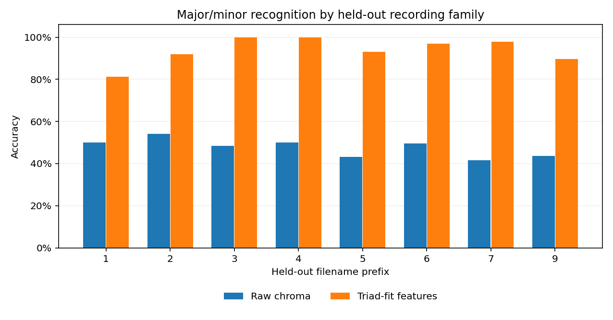

# Major or minor?

A major chord has a major third above its root. A minor chord has a minor third. I used that difference to test whether a small set of audio features could recognize chords from recording families left out of training.

## Results on held-out recordings

| Method | Accuracy | Balanced accuracy | Macro F1 |
| --- | ---: | ---: | ---: |
| Always major | 49.8% | 50.0% | 0.332 |
| Raw chroma + logistic regression | 46.6% | 46.6% | 0.466 |
| Triad-fit features + logistic regression | **94.0%** | **94.0%** | **0.940** |
| Best triad template, no training | 93.8% | 93.8% | 0.938 |

The triad features helped because the same note pattern can start on any of the 12 pitches. The rule-based template scored almost as well as the fitted model, so the command-line demo uses the rule and works without training. It also prints the best-fit root. The dataset labels cover chord quality, so the evaluation scores major versus minor only.



## How I tested it

1. Read each clip as mono and take a short-time Fourier transform. Add peak energy to 12 pitch classes, so every octave of C contributes to the C bin.
2. Give one logistic regression model those 12 values. Give the other the best major-template match, best minor-template match, and the difference between them. Each template tries every possible root.
3. Hold out one filename prefix at a time and train on all the others. For example, `6_2.wav` and `6_10.wav` always stay together, and prefix 6 is held out across both labels. Score the 502 held-out predictions together.

The set contains 250 major and 252 minor clips across eight filename families. The prefix is a conservative grouping rule because instrument, performer, and recording-session metadata were unavailable. The results apply to this collection of isolated chords.

## Run it

Use Python 3.10 or later. Try the command-line demo with any WAV recording of a single chord. To run a new evaluation, supply labeled WAV files in `major/` and `minor/` subfolders and point `--data` at their parent directory. The study groups related filenames by their prefix before the first underscore.

The reported scores came from a private collection of 502 recordings. Your results will depend on the audio you use.

```bash
python -m pip install -r requirements.txt
python study.py --data "/path/to/labeled-chord-recordings"
python predict.py "/path/to/chord.wav"
```

The [results folder](results/) contains the accuracy by family, aggregate metrics, and confusion matrix from the full run.
