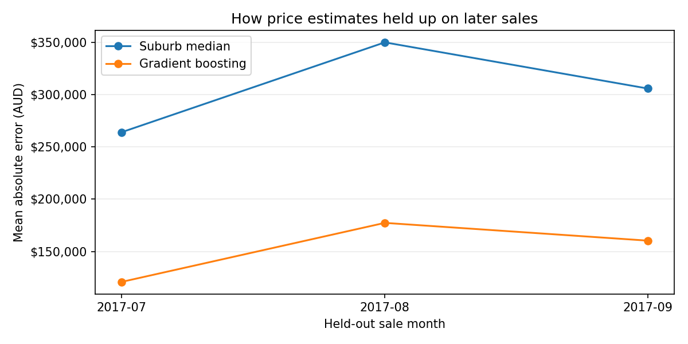

# Melbourne house price prediction

How well can earlier sales predict what homes sell for a few months later? I tested a small gradient-boosting model against a suburb-median estimate using the Melbourne Housing Snapshot.

## Results on later sales

The model trained on 10,566 sales through July 1, 2017 and tested on 3,014 sales from July 8 to September 23, 2017. Every sale on the cutoff date stayed in the test set.

| Method | Mean absolute error | Median absolute error | RMSE |
| --- | ---: | ---: | ---: |
| Overall training median | A$415,470 | A$304,000 | A$627,364 |
| Suburb training median | A$300,731 | A$176,000 | A$501,174 |
| Gradient boosting | **A$148,517** | **A$90,708** | **A$283,281** |

The model cut mean absolute error by **50.6%** against the suburb median and had lower error in each of the three test months. For 63 test sales from suburbs absent in training, the suburb baseline fell back to the overall training median. There were 25 later sales at addresses that also appeared in training. The model used location and property features, so homes at the same location can still be familiar.



## What goes into the prediction

The baseline looks up a suburb's median price using the training period. The gradient-boosting model uses property type, rooms, size, build year, coordinates, and distance to the city centre. It learns from log prices and converts its estimates back to Australian dollars. The model handles missing values directly. Street addresses, sale dates, agent names, and sale methods stay out of the model.

The errors describe a short holdout period in the 2017 snapshot. A current-price estimate would need current sales and a fresh evaluation.

## Run it

Use Python 3.10 or later. Download `melb_data.csv` from the [Melbourne Housing Snapshot on Kaggle](https://www.kaggle.com/datasets/dansbecker/melbourne-housing-snapshot). Tony Pino cleaned the publicly listed Domain.com.au sale results used for the source data.

```bash
python -m pip install -r requirements.txt
python study.py --data "/path/to/melb_data.csv"
python predict.py example_home.csv
```

`study.py` writes the model and holdout results to `outputs/`. `predict.py` writes two estimates per row, one from each method. The example row is hypothetical. Property type is `h` for house, `t` for townhouse, or `u` for unit. The field names follow the original CSV, including `Lattitude` and `Longtitude`.

The [results folder](results/) contains the aggregate results from the full run.
