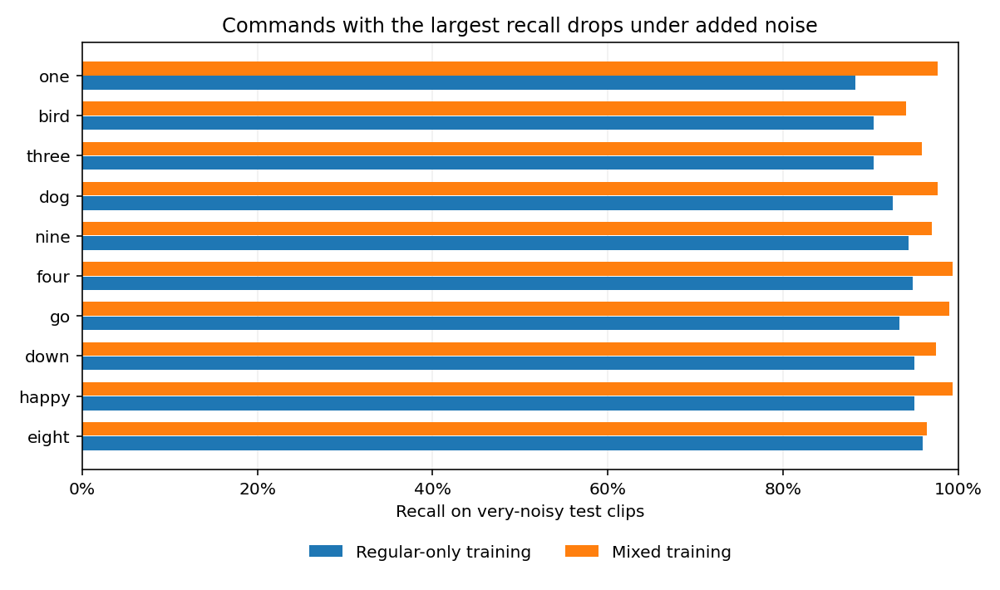

# Voice commands in noisy recordings

Which spoken commands get harder to recognize in heavier background noise, and does including that noise in training help? I tested one small convolutional model twice using 30 words from the Synthetic Speech Commands dataset.

## Results on 8,370 held-out pairs

| Training audio | Test audio | Accuracy | Macro F1 |
| --- | --- | ---: | ---: |
| Majority-word baseline | Either set | 5.7% | 0.004 |
| Regular augmentation | Regular augmentation | 99.3% | 0.993 |
| Regular augmentation | Very noisy | 96.0% | 0.959 |
| Mixed regular and very noisy | Regular augmentation | 99.5% | 0.995 |
| Mixed regular and very noisy | Very noisy | **97.9%** | **0.978** |

Adding very-noisy clips during training lifted very-noisy test accuracy by **1.9 percentage points**. The largest recall losses under heavier noise for the regular-only model were **one** (9.8 points), **bird** (7.1 points), and **three** (6.7 points). Mixing conditions brought recall for **one** from 88.2% to 97.6% on the very-noisy set.



## How the comparison works

- Match all 41,849 files by command and filename across the two folders. Both mixes of a source utterance stay together in a command-stratified 80/20 split.
- Convert each one-second clip to a small log-mel spectrogram. The spectrogram shows how energy in different frequency bands changes over time.
- Start both models with the same architecture, random initialization, and batch order. Each model sees one clip per training ID per epoch. The regular-only model always uses the regular clip. The mixed model samples one of the two versions for each ID.
- Evaluate both models on the same test IDs in both conditions and measure recall one command at a time.

Both folders contain synthetic speech with added noise. The publisher's very-noisy mix uses stronger noise and softer speech, with separately sampled noise sources and timing. The paired split controls the source utterance ID. It measures performance within this synthetic dataset. Microphone recordings, new human speakers, and words outside the 30 labels would need separate testing.

## Run it

Use Python 3.10 or later. Download both folders from Johannes Buchner's [Synthetic Speech Commands Dataset](https://www.kaggle.com/datasets/jbuchner/synthetic-speech-commands-dataset). The [dataset generation notes](https://github.com/JohannesBuchner/spoken-command-recognition/tree/master/tensorflow-speech-words) credit the BEEP pronunciation dictionary, AURORA background sounds, and eSpeak and MBROLA voices.

```bash
python -m pip install -r requirements.txt
python study.py --regular "/path/to/augmented_dataset" --noisy "/path/to/augmented_dataset_verynoisy"
python predict.py "/path/to/one-second-command.wav"
```

The study saves both models, feature caches, and evaluation tables in `outputs/`. The prediction script uses the mixed model by default and prints its three most likely commands. The [results folder](results/) contains the saved metrics and confusion matrices from the full run.
